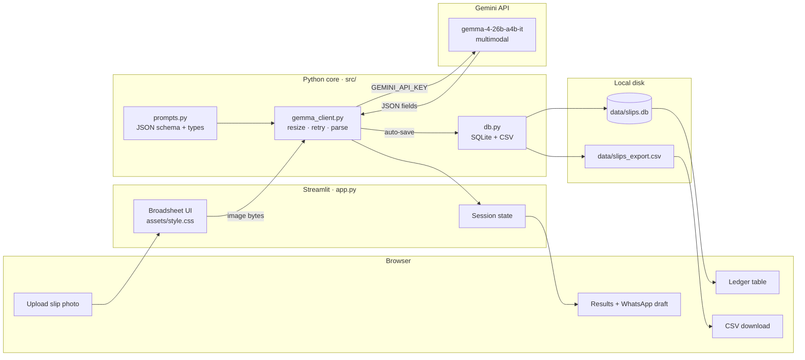

# SlipsLedger

**SlipsLedger** turns a photo of a rent or recurring housing payment slip into a structured ledger row — classified and extracted by **Gemma 4** (`gemma-4-26b-a4b-it` via the Gemini API), then saved to SQLite and exportable as CSV.

Tenants, agents, and landlords often keep rent, utility, security, cleaner, and service-charge proof as WhatsApp images or paper scraps. Those trails are easy to lose and weak in a dispute. SlipsLedger is built so the **multimodal model is the product**: upload a real slip image → Gemma returns payment type, amount, date, parties, property/unit, risk flags, and a WhatsApp-ready confirmation draft → the app auto-files the row and lets you filter the ledger or download CSV. Streamlit is the UI; SQLite is local persistence. Without a live Gemma call there is no extraction path and no mock data.

Built for **MLH Ibadan Hack Day** and **DEV Week 2** (Best Use of Gemma 4 / open-source AI). Demo locally or on Streamlit Community Cloud / DigitalOcean App Platform with `GEMINI_API_KEY` as a secret.

## Problem

Paper and WhatsApp photo trails for recurring housing payments are easy to lose and weak in a dispute. SlipsLedger turns those photos into structured ledger rows with risk flags and a WhatsApp confirmation draft.

## AI core

| Item | Value |
|------|--------|
| Model | `gemma-4-26b-a4b-it` |
| API | Gemini API (`google-genai`) |
| Env var | `GEMINI_API_KEY` |

Payment types: `rent`, `utility`, `security`, `compound_cleaner`, `service_charge`, `other`.

## Architecture

SlipsLedger is a thin vertical pipeline: **UI → Gemma 4 → SQLite → CSV**. The multimodal model is the product core; Streamlit and SQLite are presentation and persistence only. There is no mock extraction path — results exist only after a live Gemini API call.



### Request path

1. **Scan** — User uploads a PNG/JPG/WEBP in Section A. Streamlit holds the bytes in memory.
2. **Dispatch** — `analyze_slip()` downscales oversized images, calls `gemma-4-26b-a4b-it` via `google-genai` with the extraction prompt, retries transient `500`/`429`/`503`, and parses JSON (no fabricated fallback).
3. **Normalize** — Payment type is constrained to the allowed set; amounts/confidence coerced; risk flags and WhatsApp draft preserved.
4. **File** — Row is auto-inserted into SQLite (`data/slips.db`); UI shows classification, fields, risks, and copyable WhatsApp text.
5. **Ledger** — Section C lists/filters rows and streams a CSV export built from the same SQLite data.

### Component map

| Layer | Module | Responsibility |
|-------|--------|----------------|
| Presentation | `app.py`, `assets/style.css`, `.streamlit/config.toml` | Broadsheet UI, upload, results, ledger, CSV download |
| AI boundary | `src/gemma_client.py` | Only place that talks to Gemini; image prep + retries |
| Prompt contract | `src/prompts.py` | Payment types + JSON schema the model must return |
| Persistence | `src/db.py` | SQLite schema, insert/list/filter, CSV writer |
| Deploy | `Dockerfile` | Streamlit on `$PORT` for DigitalOcean App Platform |

### Trust boundary

```
[User photo] → [Streamlit process] → [Gemini API / Gemma 4] → [SQLite on disk]
                     ↑
              GEMINI_API_KEY from .env / platform secret
              (never committed; no stub JSON if missing)
```

## How to run locally

```powershell
cd C:\Users\LENOVO\Documents\week2-mlh-hacktoberfest
python -m venv .venv
.\.venv\Scripts\Activate.ps1
pip install -r requirements.txt
copy .env.example .env
# Edit .env and set GEMINI_API_KEY=your_key_from_Google_AI_Studio
streamlit run app.py
```

Open the URL Streamlit prints (usually `http://localhost:8501`).

**Emmanuel:** you must set `GEMINI_API_KEY` in `.env` (or the shell). This repo never invents or commits a key. Get one from [Google AI Studio](https://aistudio.google.com/apikey).

Test with your own real slip photos. There is no mock/stub extraction path and no seeded demo ledger — if the key is missing, the app shows an error instead of fake JSON.

## Environment variables

| Variable | Required | Description |
|----------|----------|-------------|
| `GEMINI_API_KEY` | Yes | Gemini API key used to call Gemma 4 |

See `.env.example`.

## Features

1. Upload a slip image
2. Call Gemma 4 to classify + extract fields
3. Show payment type, amount/date/parties, risk flags, WhatsApp draft
4. Save to SQLite (`data/slips.db`)
5. List / filter the ledger
6. Export CSV

## Deploy on Streamlit Community Cloud

1. Open [share.streamlit.io/deploy](https://share.streamlit.io/deploy).
2. Repository: `emarc99/week2-mlh-hacktoberfest` · Branch: `main`.
3. **Main file path:** `streamlit_app.py` (Cloud default) — or `app.py`.
4. **Advanced settings → Secrets** (TOML):

   ```toml
   GEMINI_API_KEY = "your_key_here"
   ```

   The app also reads `GEMINI_API_KEY` from the environment; Streamlit secrets are exposed as `st.secrets` — ensure the key is available (see below).
5. Deploy. Live URL looks like `https://<app-name>.streamlit.app`.

Without the secret, Analyze will fail — there is no mock path.

## Deploy on DigitalOcean App Platform

1. Redeem your Hack Day DigitalOcean credit.
2. Create an App from this GitHub repo (`emarc99/week2-mlh-hacktoberfest`).
3. Use the included `Dockerfile` (Streamlit binds to `$PORT`).
4. Add secret `GEMINI_API_KEY` with your Gemini key.
5. Deploy and paste the live URL into the Ibadan OrganizerHQ form.

## Project layout

```
streamlit_app.py            # Community Cloud entrypoint → app.py
app.py                      # Streamlit broadsheet UI (orchestration)
assets/style.css            # Newsprint theme (portfolio-aligned)
.streamlit/config.toml      # Paper/ink Streamlit theme
src/gemma_client.py         # Gemma 4 multimodal client (AI boundary)
src/prompts.py              # Classification / extraction prompts
src/db.py                   # SQLite ledger + CSV export
Dockerfile                  # App Platform container
data/                       # slips.db created at runtime (gitignored)
```

## License

MIT — see [LICENSE](LICENSE).
